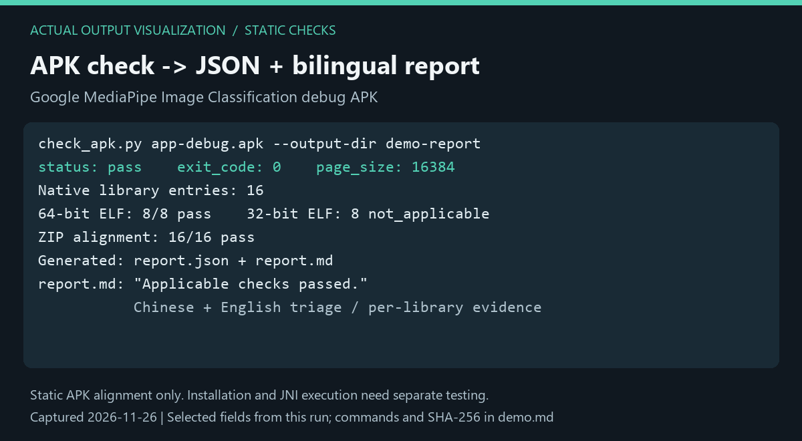

# Android SDK Toolkit

[简体中文](README.zh-CN.md)

[](https://github.com/LeeJUNhao791/android-sdk-toolkit/actions/workflows/ci.yml)
[](https://github.com/LeeJUNhao791/android-sdk-toolkit/releases/latest)
[](LICENSE)

Small command-line tools and Agent Skills for delivering and integrating Android SDKs.



Actual output visualization from a real MediaPipe debug APK, captured on 2026-11-26. Static alignment checks; installation and JNI execution require separate tests. [Reproduce the run and check the input hash](docs/assets/demo.md).

## AAR delivery check

Find missing files before handing an AAR to another team. For example, an AAR
with `jni/arm64-v8a/libdevice.so` and no `jni/x86_64/libdevice.so` fails a contract
that requires both ABIs.

Run the check with Python 3.8 or newer. It uses only the standard library.

```sh
python skills/aar-delivery-check/scripts/check_aar.py vendor.aar --expect skills/aar-delivery-check/examples/expect.json
```

Use `native_libraries` to map library filenames to required ABIs. Use
`required_entries` for exact archive paths, such as `proguard.txt` if the
delivery calls for that file. The script always requires `AndroidManifest.xml`.
The JSON report lists the checked paths and missing entries. Exit 0 means
pass, 1 means a delivery check failed, and 2 means invalid input.

### Try the missing-entry fixtures

Run these commands separately. The last two checks return exit code 1.

```sh
python skills/aar-delivery-check/examples/generate.py build/aar-fixtures
python skills/aar-delivery-check/scripts/check_aar.py build/aar-fixtures/complete.aar --expect skills/aar-delivery-check/examples/expect.json
python skills/aar-delivery-check/scripts/check_aar.py build/aar-fixtures/missing-x86_64.aar --expect skills/aar-delivery-check/examples/expect.json
python skills/aar-delivery-check/scripts/check_aar.py build/aar-fixtures/missing-r8-rules.aar --expect skills/aar-delivery-check/examples/expect.json
```

The fixtures use small test ELF headers. Build the Android example below
to check complete NDK-built libraries.

### Verify native architecture

Add `--verify-abi` to compare the ELF class and machine with each present
entry listed in `native_libraries`. Android uses little-endian ELF. Missing
entries stay in `missing_entries`. Header results appear in `abi_checks`,
including the expected and detected ABI when available.

```sh
python skills/aar-delivery-check/scripts/check_aar.py build/aar-fixtures/wrong-abi.aar --expect skills/aar-delivery-check/examples/expect.json --verify-abi
```

This fixture has every expected path. The library under
`jni/arm64-v8a/libdevice.so` contains an x86-64 header, so ABI verification
reports `abi_mismatch` and returns exit code 1. Check the final APK and run
the app to verify native loading. See the
[Android ABI guide](https://developer.android.com/ndk/guides/abis).

### Build the Android example

The [example SDK](examples/android-sdk) uses JDK 17, Android SDK Platform 35,
NDK `28.2.13676358`, and CMake `3.22.1`. Run from its directory:

```sh
./gradlew :sdk:assembleRelease
```

On Windows, use `gradlew.bat`. From the repository root, check the real AAR:

```sh
python skills/aar-delivery-check/scripts/check_aar.py examples/android-sdk/sdk/build/outputs/aar/sdk-release.aar --expect skills/aar-delivery-check/examples/expect.json --verify-abi
python -B -m unittest discover -s skills/aar-delivery-check/tests -v
```

Copy [`skills/aar-delivery-check`](skills/aar-delivery-check) to your Agent Skills
directory to use it as a Skill. See the
[Android AAR documentation](https://developer.android.com/studio/projects/android-library#aar-contents)
for the archive layout.

## Inspect AARs already present in a project

Included starting with the `v0.12.0` source archive. Keep `android-project-check`,
`aar-delivery-check` and `apk-page-size-check` together under `skills/`.

Run a read-only check of direct `app/libs/*.aar` and
`uni_modules/*/utssdk/app-android/libs/*.aar` files in a supplied project root:

```sh
python skills/android-project-check/scripts/check_project.py "/path/to/project" --output-dir "/path/to/new-evidence"
```

JSON lists stable relative source paths, AAR/SO SHA-256, manifest presence,
discovered ABIs and 64-bit ELF `PT_LOAD` alignment. Optional output is a new
directory outside the project containing `report.json` and an English/Chinese
`report.md`. Existing paths are preserved. This command does not build, modify
the project or search dependency caches.

No ABI is required by default. Repeat `--expect-abi arm64-v8a` (or another ABI)
to require it in **every** AAR, including Java-only AARs. Exit codes are `0`
pass, `1` failed check, `2` invalid input/output and `3` `no_matches` (not a
pass); invalid input takes precedence in mixed results. `elf64_count: 0`
explicitly means no 64-bit ELF alignment was evaluated. Manifest checks cover
presence/readability only; AAR ZIP layout does not establish APK ZIP alignment
or device/JNI behavior. ZIP compression is limited to Stored/Deflated;
other methods are invalid. See the [project check guide](skills/android-project-check/SKILL.md)
for archive, native-entry, path and output boundaries.

## JNI load diagnosis

Give the checker the final APK, the app's selected ABI, and a log from the
same failed run.

```sh
python skills/android-jni-doctor/scripts/jni_doctor.py app.apk --abi arm64-v8a --log app-log.txt
```

Use `--library libdevice.so` when you know the library and the log omits its
filename. The JSON report identifies a missing APK entry, an ELF architecture
mismatch, or a logged JNI binding failure when the evidence supports it.
Exit 0 means the report was produced, including an undetermined result.
Exit 2 means invalid input.

The package check covers the supplied APK. Installed split APKs, system
libraries, and runtime `RegisterNatives` behavior may need separate evidence.
See the [Android JNI guide](https://developer.android.com/ndk/guides/jni-tips).

Build `:app:assembleDebug` in [the Android example](examples/android-sdk)
and install its debug APK on a test device or emulator. Launch it with
`adb shell am start -S -n io.github.leejunhao791.sdktoolkit.demo/.MainActivity`
to run the successful native call. Add `--es scenario missing` for a
missing-library error or `--es scenario binding` for a method-binding error.
The `SdkToolkitDemo` log tag records the result. Capture that log in UTF-8
for the checker.

Run the diagnosis tests with
`python -B -m unittest discover -s skills/android-jni-doctor/tests -v`.

## Check 16 KB alignment in a final APK

```sh
python skills/apk-page-size-check/scripts/check_apk.py app.apk
```

The checker uses Python 3.8 or newer and the standard library. It inspects
`lib/<abi>/*.so` entries in the supplied APK:

- For ARM64 and x86-64 libraries, every ELF `PT_LOAD` segment must declare a
  power-of-two alignment of at least 16 KB. Its file offset and virtual
  address must be congruent modulo that alignment.
- For uncompressed libraries in the four supported Android ABIs, the ZIP
  entry's data must start at a 16 KB boundary. Compressed 64-bit libraries
  still get the ELF check.

The JSON report lists the affected paths, LOAD program headers and ZIP data
offsets. Exit 0 means the scoped alignment checks passed, 1 means an alignment
failure, 2 means invalid or unsupported input, and 3 means there were no
64-bit libraries and no ZIP alignment failures. A single APK report covers
that file. For a split delivery, check each distributed APK.

A pass is static alignment evidence. GNU_RELRO layout and APK installation and
JNI execution on a 16 KB Android system require separate checks. See
[Android's 16 KB page size guide](https://developer.android.com/guide/practices/page-sizes)
and the [runtime procedure below](#verify-the-aar-on-an-android-device).

Use the [16 KB troubleshooting guide](docs/16kb-troubleshooting.md) to fix
ELF or ZIP failures and follow a WebRTC example that traces a failing library
to its AAR version.

### Use the GitHub Action

After building the final APK in your workflow, add this step. The action sets
up Python 3.11 and writes a Markdown table to the job summary.

```yaml
- name: Check APK 16 KB alignment
  id: alignment
  uses: LeeJUNhao791/android-sdk-toolkit@v0.10.0
  with:
    apk: app/build/outputs/apk/release/app-release.apk
    # Optional, using the resolved AAR manifest described below:
    aar-manifest: build/resolved-aars.json
- name: Save the JSON report
  if: always() && steps.alignment.outputs.report != ''
  uses: actions/upload-artifact@v7
  with:
    name: apk-16kb-report
    path: ${{ steps.alignment.outputs.report }}
```

Pin the action to a reviewed commit SHA for a stable dependency. Paths are
absolute or relative to the caller's workspace. AAR paths inside the manifest
remain relative to the manifest itself. The caller can use `contents: read`
repository permissions. The check requires no Android SDK installation.

The `status`, `exit-code`, and `report` outputs retain the checker's result and
JSON report path even on a failed check. Alignment failures (exit code 1) and
invalid inputs (2) fail the step. A check with no applicable 64-bit libraries
and no ZIP failures succeeds with `status: not_applicable` and `exit-code: 3`.
The summary labels this state explicitly. It also lists `single_candidate`,
`multiple_candidates`, or `unknown` when the AAR manifest is supplied, and
`not_requested` when candidate matching was not requested.

Follow the [WebRTC Gradle example](https://github.com/LeeJUNhao791/android-delivery-workflows/blob/3101b54c63e57b06234448f50ee22e73b882451c/examples/apk-16kb-action/README.md#check-a-gradle-built-apk-with-a-third-party-sdk)
to build a debug APK, export the resolved runtime AARs, and run the action.
The [APK verification job](https://github.com/LeeJUNhao791/android-delivery-workflows/actions/runs/44472134100/job/135383913161)
shows the original APK passing and an intentionally unaligned ZIP copy failing
with the WebRTC AAR listed as a candidate. Download both JSON reports from
the `webrtc-apk-16kb-reports` artifact in the
[run summary](https://github.com/LeeJUNhao791/android-delivery-workflows/actions/runs/44472134100) while it is retained.

The [MediaPipe Gradle example](https://github.com/LeeJUNhao791/android-delivery-workflows/blob/d5f43e846744f53d0c8a90260dd32b217bf8b935/examples/apk-16kb-action/README.md#check-the-upstream-mediapipe-image-classification-apk)
shows how to export AARs from a multi-module Kotlin DSL app. The original
Debug APK passed in a [GitHub-hosted CI run](https://github.com/LeeJUNhao791/android-delivery-workflows/actions/runs/44480978736).
Download `mediapipe-apk-16kb-report` from that run for the JSON report and
the resolved runtime AAR manifest.

### Find candidate AARs for failing native libraries

Record the external AAR artifacts Gradle actually resolved on the runtime
classpath of the module and variant that built the APK. Include transitive
AARs and use resolved `group:module:version` coordinates. Save the classpath,
coordinates and artifact paths in a UTF-8 JSON manifest. Relative paths start
at the manifest's directory. Absolute paths also work.

For a Kotlin DSL app, you can register the AAR export task in a Gradle init
script and pass it with `--init-script` when you build the APK. In a multi-module
app, use Gradle's `artifactView` and filter for `ModuleComponentIdentifier`
before resolving files. Resolving all artifacts before filtering can fail
when a local Android module publishes several artifact variants. Run the action
in the same job if the manifest points into that job's Gradle cache.

If Maven or model downloads stall on a network that requires a proxy, check
[Gradle's JVM proxy settings](https://docs.gradle.org/current/userguide/networking.html).

```json
{
  "consumer_configuration": ":app:demoDebugRuntimeClasspath",
  "artifacts": [
    {"coordinate": "example:device-sdk:1.0", "path": "aars/device-sdk-1.0.aar"},
    {"coordinate": "example:vision-sdk:2.0", "path": "aars/vision-sdk-2.0.aar"}
  ]
}
```

```sh
python skills/apk-page-size-check/scripts/check_apk.py app.apk --aar-manifest resolved-aars.json
```

For each ELF or ZIP alignment failure, `origin` compares the APK's
`lib/<abi>/<name>.so` payload with `jni/<abi>/<name>.so` in the supplied AARs.
It reports `single_candidate`, `multiple_candidates`, or `unknown` based on
matching SHA-256 digests. Each candidate lists the supplied coordinate, AAR
path and matching entry. An invalid manifest or unreadable AAR returns exit 2.

The checker trusts the supplied classpath label and coordinates. A byte match
identifies a candidate within that list, and a ZIP offset is determined by
final APK packaging. Stripping or other changes to library bytes, app-local
libraries and omitted artifacts can yield `unknown`. The APK-only command
reports alignment without AAR attribution.

In the [MediaPipe Image Classification sample](https://github.com/google-ai-edge/mediapipe-samples/tree/46d60d66baf21ae91977c488ea0875f0e13c4d2b/examples/image_classification/android),
the Debug APK passed. Its packaged `libmediapipe_tasks_jni.so` differed from
the AAR bytes after the Gradle strip task. The merged libraries before that
task matched the transitive AAR `com.google.mediapipe:tasks-core:1.2.2`.
Use [same-build provenance](#trace-a-stripped-library-from-the-same-gradle-build)
to check this relationship.

Try the synthetic example below. Both AARs have the same native filenames.
The check returns exit 1 and reports one candidate for `libunique.so`, two
for `libshared.so`, and `unknown` for `libchanged.so`.

```sh
python skills/apk-page-size-check/examples/generate_origins.py build/apk-origins
python skills/apk-page-size-check/scripts/check_apk.py build/apk-origins/app.apk --aar-manifest build/apk-origins/resolved-aars.json
```

### Trace a stripped library from the same Gradle build

For an Android application module with one APK per selected variant, the
[native provenance example](skills/apk-page-size-check/examples/export-debug-native-provenance.init.gradle)
builds the APK and writes the resolved AAR manifest and native provenance JSON.
It defaults to `:app` and `debug`, preserving the original command and
`app/build/reports/apk-16kb/` paths below. Set `TOOLKIT` to an absolute path to
this checkout. Run from the Android project's Gradle root. In PowerShell use
the Gradle batch wrapper and set `$env:TOOLKIT` to the checkout path.

```sh
./gradlew --no-configuration-cache --init-script "$TOOLKIT/skills/apk-page-size-check/examples/export-debug-native-provenance.init.gradle" :app:exportDebugNativeProvenance
python "$TOOLKIT/skills/apk-page-size-check/scripts/check_apk.py" app/build/outputs/apk/debug/app-debug.apk \
  --aar-manifest app/build/reports/apk-16kb/resolved-aars.json \
  --native-provenance app/build/reports/apk-16kb/native-provenance.json
```

Starting with `v0.11.0`, use the generic task to select another application module
in the invoked main build and an exact enabled AGP variant name, including
product flavors. These options are not in the `v0.10.0` exporter:

```sh
./gradlew --no-configuration-cache --init-script "$TOOLKIT/skills/apk-page-size-check/examples/export-debug-native-provenance.init.gradle" \
  -PtoolkitProvenanceModule=:mobile -PtoolkitProvenanceVariant=demoRelease :mobile:exportNativeProvenance
```

The properties default to `:app` and `debug`; use module `:` for an application
at the Gradle root. The task must belong to the selected module.
`exportDebugNativeProvenance` is available only when the
selected variant is exactly `debug`. Unknown modules, non-application modules,
unknown or disabled variants, and multiple APK outputs fail without falling
back to another module or variant. Split APK export is unsupported.

Both JSON files are written under the selected module's Gradle build directory:
`reports/apk-16kb/` for `debug`, or `reports/apk-16kb/<variant>/` otherwise.
For the example above, the default build directory gives
`mobile/build/reports/apk-16kb/demoRelease/`. The APK comes from AGP's artifact
provider, and AARs come from that same variant's runtime configuration. Use the
APK path printed by the exporter with those two sidecars in `check_apk.py`.
Module, Debug/Release and flavor selection were verified with AGP 8.13.1;
the original Debug flow was also verified with the pinned MediaPipe sample and
AGP 8.13.2. The strip task's input/output directories are internal AGP details,
so other AGP versions need separate verification.

Treat these files as the current export only after Gradle succeeds. On entering
the export task, its previous two JSON files are removed before validation.
If assembly fails before export runs, historical files may remain; they do not
prove that failed build. The checker verifies APK and manifest hashes, not the
time of a Gradle invocation.

The following workflow stays pinned to `v0.10.0` for the original `:app` Debug
flow. Use its matching Gradle exporter and pass both files in the job that built
the APK. Module and variant selection require the `v0.11.0` exporter.

```yaml
- uses: LeeJUNhao791/android-sdk-toolkit@v0.10.0
  with:
    apk: app/build/outputs/apk/debug/app-debug.apk
    aar-manifest: app/build/reports/apk-16kb/resolved-aars.json
    native-provenance: app/build/reports/apk-16kb/native-provenance.json
```

The option reports origins for all packaged native libraries. It verifies the
APK and AAR manifest hashes first. For a changed library, the APK entry hash
must equal the strip output hash, and the merged input hash must match the
corresponding AAR entry. The JSON marks that method as `gradle_strip_chain`
and includes `merged_sha256` alongside the APK entry's `sha256`. With no usable
chain, the report uses `direct_sha256`. If the APK or manifest hash differs,
the report labels the mismatch and uses direct matching. A verified chain
with zero or several AAR matches keeps its `unknown` or `multiple_candidates`
status. The evidence describes a trusted local Gradle build, and the candidate
list is limited to the supplied resolved external AARs.

If ELF passes and ZIP fails, check APK packaging and alignment. Candidate coordinates list
matching AAR entries.

### Draft a bilingual supplier report

To scan a final APK and save both JSON and a bilingual Markdown draft in one
command:

```sh
python skills/apk-page-size-check/scripts/check_apk.py "app with spaces.apk" --aar-manifest resolved-aars.json --native-provenance native-provenance.json --output-dir "build/apk evidence/run-1"
```

The sidecar flags are optional; `--native-provenance` requires `--aar-manifest`.
The output directory must be new, including on retries. It receives UTF-8
`report.json` and `report.md`; stdout remains the scanner JSON. Invalid inputs
produce JSON and an explicit invalid-input Markdown note. Successful evidence
generation preserves scanner exits `0`, `1`, `2`, and `3`. A directory or report
generation error returns `2` with stderr; if scanning already finished, its
JSON status remains on stdout and any written evidence is retained. Check the
command exit and stderr as well as the JSON status before treating the evidence
generation as complete.

Save the checker JSON, then turn it into an English and Simplified Chinese
Markdown draft. Run the commands separately: an alignment failure returns
exit `1` and still writes JSON.

```sh
python skills/apk-page-size-check/scripts/check_apk.py app.apk --aar-manifest resolved-aars.json > apk-16kb.json
python skills/apk-page-size-check/scripts/render_vendor_report.py apk-16kb.json -o vendor-report.md
```

For stripped libraries, add `--native-provenance native-provenance.json` from
the same build to the first command. For ELF failures, the draft includes the
available APK SO SHA-256. A single direct byte match adds the AAR coordinate
and member; a verified strip chain with one AAR candidate also adds the
pre-strip SO SHA-256. These digests identify SO contents, not the full APK or
AAR archives. ZIP-only failures point to app packaging. A verified strip chain
first calls for checking the AAR member's ELF alignment before assigning a
supplier fix.

Choose a new output file; the renderer preserves existing files. It returns
`0` for a written draft and `2` for unusable JSON or an output error. Review
the draft before sharing; local paths are omitted. Installation and JNI
execution on a 16 KB system require separate verification. See the
[report guide](docs/16kb-troubleshooting.md#draft-a-report-for-a-supplier).

## Package and verify an SDK handoff

Publish a Gradle AAR or JAR into a fresh local Maven repository, then check
that a separate consumer can use the published coordinate. Set `JAVA_HOME`
to a JDK 17 installation for the examples and run from the repository root.

```sh
python skills/android-sdk-pack/scripts/publish_sdk.py examples/android-sdk examples/consumers/android --kind aar --coordinate io.github.leejunhao791.sdktoolkit:device-sdk:0.1.0 --output build/handoff-aar
python skills/android-sdk-pack/scripts/publish_sdk.py examples/java-sdk examples/consumers/java --wrapper examples/android-sdk --kind jar --coordinate io.github.leejunhao791.sdktoolkit:java-device-sdk:0.1.0 --output build/handoff-jar
```

Choose a fresh output directory for each run. The script delivers the Maven
repository after it verifies the selected artifact on a consumer runtime
classpath and the smoke task succeeds. It matches the resolved Maven
coordinate and compares SHA-256 with the freshly published AAR or JAR.
The JSON includes the artifact and POM paths and `consumer_artifact_verified`.
The Android consumer assembles an APK that compiles a call to the SDK. The Java
consumer runs a call that uses a transitive dependency declared by the JAR
producer.

For your own SDK, use a Gradle Maven repository named `handoff` that reads
`toolkitRepo` as its URL. The consumer resolves `toolkitCoordinate` from
`toolkitRepo`, then exposes `assembleDebug` for AARs or `run` for JARs. The
[SDK packaging Skill](skills/android-sdk-pack) and the example projects show
the required setup. The script invokes Gradle builds from the supplied projects.

For multiple matching tasks or Android flavors, pass a full Gradle task path
with `--consumer-task`, such as `:app:assembleDemoDebug` for an AAR or
`:cli:run` for a JAR. The artifact check uses that task's project and runtime
classpath, such as `demoDebugRuntimeClasspath` for `assembleDemoDebug`.

Run the handoff tests with
`python -B -m unittest discover -s skills/android-sdk-pack/tests -v`.

### Verify the AAR on an Android device

Use a phone, development board, or emulator running 64-bit Android 6.0 (API 23)
or later. Enable ADB and check that the system exposes `arm64-v8a` or `x86_64`.
For ARM64 acceptance, use `arm64-v8a`. Run from the repository root with the
Android build tools listed above. Use a fresh
`build/device-handoff` directory. On Windows, use `gradlew.bat` in place of
`gradlew`.

```sh
python skills/android-sdk-pack/scripts/publish_sdk.py examples/android-sdk examples/consumers/android --kind aar --coordinate io.github.leejunhao791.sdktoolkit:device-sdk:0.1.0 --output build/device-handoff
./examples/android-sdk/gradlew -p examples/consumers/android "-PtoolkitRepo=$PWD/build/device-handoff" "-PtoolkitCoordinate=io.github.leejunhao791.sdktoolkit:device-sdk:0.1.0" :assembleDebug :assembleDebugAndroidTest
adb install -r examples/consumers/android/build/outputs/apk/debug/aar-consumer-debug.apk
adb install -r -t examples/consumers/android/build/outputs/apk/androidTest/debug/aar-consumer-debug-androidTest.apk
adb shell am instrument -w -r io.github.leejunhao791.sdktoolkit.consumer.test/io.github.leejunhao791.sdktoolkit.consumer.JniSmokeRunner
```

If multiple devices are connected, pass `-s SERIAL` to each ADB command.
The test calls `DeviceSdk.roundTrip(42)` through the consumer app. A pass
includes `jni_result=42` and `INSTRUMENTATION_CODE: -1`. For ARM64, check
`process_64_bit=true` and confirm that the following command shows
`primaryCpuAbi=arm64-v8a`:

```sh
adb shell dumpsys package io.github.leejunhao791.sdktoolkit.consumer
```

Measure the device's page size with `adb shell getconf PAGE_SIZE` before
running the test. A 16 KB environment reports `16384`.

| Device | Android | App ABI | Page size | JNI result |
| --- | --- | --- | --- | --- |
| Pixel 4 XL | 11 (API 30, `RQ2A.210505.002`) | `arm64-v8a` | Unrecorded | Pass, returned `42` in a 64-bit process |
| Qualcomm Kalama | 15 (API 35, `AQ3A.250716.002`) | `arm64-v8a` | 4 KB (`4096`) | Pass, returned `42` in a 64-bit process |
| OnePlus PJA110 | 16 (API 36, `BP2A.250605.015`) | `arm64-v8a` | 4 KB (`4096`) | Pass, returned `42` in a 64-bit process |
| Qualcomm Volcano | 16 (API 36, `BQ2A.250622.001-BP2A.250605.031.A3`) | `arm64-v8a` | 4 KB (`4096`) | Pass, returned `42` in a 64-bit process |

Runtime checks on an ARM64 device with 16 KB pages and on Android 6.0
(API 23) are pending.

## Regression checks

[SDK Toolkit CI](https://github.com/LeeJUNhao791/android-sdk-toolkit/actions/workflows/ci.yml) runs the Skill tests on
Windows and Linux. The Linux integration job builds the JNI test APK and
checks the real AAR and JAR examples. It rejects an x86-64 library in the ARM64
AAR path and verifies that the selected consumer module and variant resolve
the published SDK bytes at the requested coordinate. It runs the 16 KB
alignment preflight and Android Build Tools' `zipalign` on the real Android
consumer APK. The Python tests also use generated APKs to isolate ELF and ZIP
alignment failures.

With JDK 17 and the Android tools listed above, run the integration tests
locally from the repository root:

```sh
python -B -m unittest discover -s tests -v
```

## License

[Contributing](CONTRIBUTING.md) · [MIT](LICENSE)
